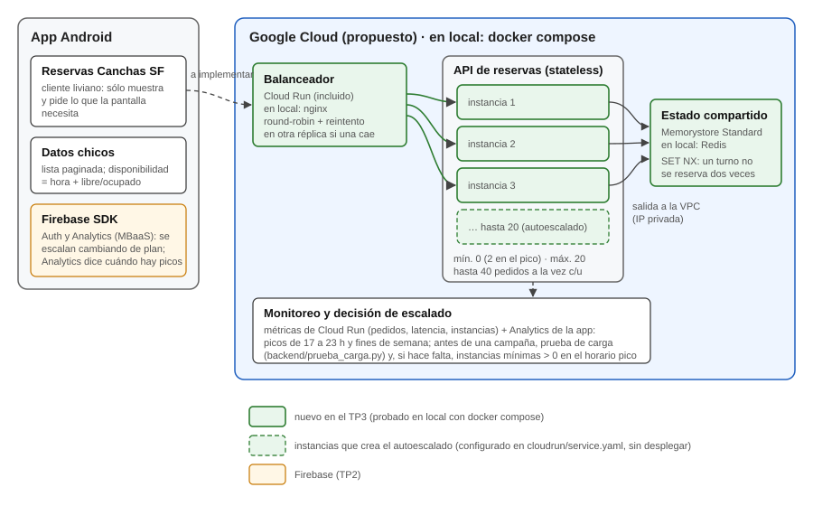

# Trabajo Práctico 3 — Estrategias de Escalabilidad

**Cátedra:** Arquitecturas Móviles · Ing. Juan Pablo Bono  
**Carrera:** Ingeniería en Sistemas de Información — UTN FR San Francisco  
**Alumno:** Fernando Mare  
**Fecha:** 21/10/2026  
**Repositorio:** https://github.com/mareFernando03/reservas-canchas-sf (carpeta `backend/`)

---

## 1. Objetivo

Según la guía del TP3: desarrollar una estrategia para escalar la app de los prácticos anteriores
(Reservas Canchas SF), considerando balanceo de carga, redundancia y autoescalado; configurar
servicios en la nube para soportarla y actualizar el diagrama de arquitectura.

## 2. Lectura: capítulo 16 de *Lean Mobile App Development*

El capítulo 16 ("Scaling Strategies") se resume en una idea: **hacer la app escalable, pero no
escalarla antes de tiempo** (p. 397-398). Mientras no se validó la hipótesis, escalar es perder el
tiempo; pero si la app de golpe se vuelve popular y no puede crecer rápido, se cae, los usuarios
se van y el momento se pierde. Los puntos que se tomaron para este práctico:

- **Sobre todo, del backend.** La distribución de la app la resuelve la tienda (p. 399); lo que
  hay que preparar es el servidor, si la app usa uno. Pero el libro aclara que la escalabilidad no
  es sólo el backend: todo lo que necesita intervención manual también la limita, por eso hay que
  automatizar (p. 398).
- **Nube desde el principio.** IaaS (AWS, Azure, Google Cloud) o MBaaS (Firebase, Parse): las dos
  escalan sin mucho esfuerzo (p. 401). El MBaaS es más cómodo pero más caro al crecer y genera más
  dependencia del proveedor (p. 403). Escalar Firebase se reduce a cambiar de plan, pero no trae
  autoescalado propio (p. 413).
- **Visto desde el cliente.** A la app sólo le importa la interfaz, una API REST con JSON
  (p. 404). Para conexiones lentas hay que mandar lo mínimo, paginar ("cargar más") y guardar en
  caché (p. 404-405).
- **Saber cuándo escalar.** Lo importante es la cantidad de usuarios *simultáneos*. Las métricas
  de uso y la estacionalidad dicen cuándo subir y cuándo bajar capacidad (p. 407).
- **La historia de terror.** El autor cuenta una app de votación para un programa de televisión
  cuyo backend prometía al menos 100.000 usuarios y dejó de funcionar con unos 40.000 en la
  primera emisión. Admite que nunca preguntó si se había hecho una prueba de carga, y concluye que
  con una prueba así y la posibilidad de escalar rápido quizás se habría evitado. La lección:
  romper las cosas antes de que lo hagan los usuarios (p. 408-409).
- **Escalar o refactorizar.** Agregar servidores no arregla una mala arquitectura (p. 410). Buenas
  prácticas: app liviana, interfaz (API) primero, poco tráfico de datos y autoescalado donde se
  pueda, que sube y baja instancias según el tráfico o según horarios (p. 410-412).

> **Nota.** La guía propone una discusión en grupo sobre los desafíos de escalar. Este práctico
> se hizo de forma individual; los desafíos aplicados a esta app están en la sección 3.2.

## 3. Estrategia de escalabilidad

### 3.1. Cómo se usaría la app

Hipótesis de uso, a validar con el Analytics que la app tiene desde el TP2 (el libro insiste en
que eso lo dicen las métricas, p. 407): los turnos son de 17 a 23 h, la gente reserva sobre todo
esa misma tarde o el día anterior, y los fines de semana hay más partidos. De madrugada casi no
habría uso. Los picos imprevistos vendrían de una campaña, por ejemplo un torneo o una promoción
con un club grande. Esto define la estrategia: **capacidad que sube y baja sola**, sin pagar
servidores ociosos de noche.

### 3.2. Desafíos propios de esta app

- **Doble reserva:** con varias instancias, dos personas pueden pedir el mismo turno al mismo
  tiempo y no pueden ganar las dos.
- **Arranque en frío:** con cero instancias mínimas, el primer pedido de la tarde espera a que
  levante una instancia.
- **Punto único de falla:** si todo depende de una sola pieza (una instancia, un Redis), su caída
  tira el servicio.
- **Costo:** la capacidad que no se usa se paga igual.

### 3.3. Decisiones

| Aspecto | Decisión | Por qué |
|---|---|---|
| Usuarios y medición | Seguir en Firebase (Auth y Analytics). | Alcanza para validar, que es lo que el libro recomienda para empezar (p. 414). Escalarlo es cambiar de plan (p. 413); el libro advierte que no trae autoescalado propio, pero acá sólo atiende login y medición, no el tráfico de reservas. |
| Backend propio | Una **API REST sin estado** para canchas, disponibilidad y reservas. | Para mostrar la disponibilidad real de horarios (RF08) hace falta un backend. Sin estado, cualquier instancia puede atender cualquier pedido. La app todavía no la consume: es el paso siguiente. |
| Estado | Las reservas, en un **almacén compartido**: Redis en local, Memorystore en nivel Standard en la nube. | Si cada instancia guardara sus reservas, dos instancias podrían vender el mismo turno. El nivel Standard tiene réplica y conmutación automática; con un Redis único, Redis pasaría a ser el punto único de falla. |
| Balanceo de carga | Un **balanceador** delante de las instancias. | Reparte los pedidos y saca de servicio a la instancia que falla. |
| Redundancia | Cloud Run reemplaza sola una instancia que se cae y es regional (repartida en zonas). Para el horario pico, **dos instancias mínimas**, programadas con Cloud Scheduler. | Una instancia sola es un punto único de falla. Es el escalado "por horario" del libro (p. 412). |
| Autoescalado | **Google Cloud Run**: de 0 a 20 instancias; cada una atiende hasta 40 pedidos a la vez y Cloud Run agrega o saca instancias según la concurrencia y el uso de CPU. | Con 0 de mínimo no se paga de madrugada. El máximo limita el gasto si hay un pico inesperado. |
| Datos al móvil | Lista **paginada** y disponibilidad reducida a hora y libre/ocupado. | Lo que pide el libro para conexiones lentas (p. 404-405). Como la disponibilidad cambia, el caché en el teléfono tiene que ser corto (segundos). |
| Antes de una campaña | **Prueba de carga** y, si hace falta, más instancias mínimas en el horario pico. | La lección de la historia de terror del capítulo. |

## 4. Configuración de los servicios

### 4.1. API de reservas (`backend/app.py`)

API en Python (FastAPI) con estas operaciones: estado (`GET /vivo` y `GET /salud`), lista paginada
de canchas (`GET /canchas?pagina=&tamanio=`), disponibilidad de un día
(`GET /canchas/{id}/turnos?fecha=`) y reservar (`POST /reservas`). Para reservar usa la operación
`SET NX` de Redis, que es atómica: si dos instancias reciben el mismo turno al mismo tiempo, sólo
una lo consigue y la otra responde `409`. Si el mismo usuario reintenta su reserva (por ejemplo,
porque no le llegó la respuesta), recibe `200`: el turno ya es suyo y no se reserva dos veces. Cada
respuesta lleva el encabezado `X-Instancia`, para ver qué instancia la atendió.

La app reserva de 1 a 3 horas y la API reserva de a una. Para varias horas habría que usar
`MSETNX`, que también es atómico.

### 4.2. Balanceo y redundancia en local (`backend/docker-compose.yml`)

Para probar la estrategia sin depender de una cuenta en la nube, se armó el mismo esquema con
Docker Compose: **réplicas** de la API (tres por defecto), **Redis** como estado compartido y
**nginx** como balanceador (`backend/nginx.conf`). nginx reparte los pedidos por turnos
(*round-robin*) y, si no puede conectarse a una réplica o ésta falla, reintenta el pedido en otra
(`proxy_next_upstream`). Los POST sólo se reintentan si todavía no llegaron a la réplica, para no
procesar dos veces una reserva. Escalar es un comando: `docker compose up -d --scale api=5`.

### 4.3. Autoescalado en la nube (`backend/cloudrun/service.yaml`)

La configuración para Google Cloud Run deja escrito el autoescalado (`minScale: 0`,
`maxScale: 20`, `containerConcurrency: 40`), la salida a la red privada donde está Memorystore y
los comandos para crear todo lo necesario y programar las dos instancias mínimas del horario pico.
Cloud Run ya incluye el balanceador, así que no hace falta nginx. **No se desplegó**: habilitar la
facturación de Google Cloud requiere una tarjeta, y Memorystore no tiene capa gratuita. El
autoescalado queda configurado pero sin probar.

## 5. Pruebas

Se corrió todo en una sola computadora con Docker Desktop, con `python backend/pruebas.py`, que
hace las cinco pruebas de punta a punta y deja la salida en `docs/TP3-pruebas.log`. La carga
(`backend/prueba_carga.py`) pide la disponibilidad de una cancha con 50 pedidos en paralelo.

| Prueba | Resultado |
|---|---|
| 0. Línea base con 1 réplica (2.000 pedidos) | 0 fallidos. 186 pedidos/s; mediana 228 ms, p95 479 ms. |
| 1. Carga con 3 réplicas (2.000 pedidos) | 0 fallidos. 325 pedidos/s; mediana 145 ms, p95 250 ms. El balanceador repartió 666 / 667 / 667. |
| 2. El mismo turno pedido por 20 usuarios a la vez | 1 reserva aceptada (`201`) y 19 rechazadas (`409`), atendidas por las 3 réplicas. El turno quedó ocupado una sola vez. El ganador reintenta y recibe `200`; otro usuario recibe `409`. |
| 3. Se cae una réplica a los 2 s de empezar (4.000 pedidos) | 0 fallidos. La réplica caída alcanzó a atender 283 pedidos y las otras dos absorbieron el resto (1.859 y 1.858). |
| 4. Escalado a 5 réplicas (2.000 pedidos) | 0 fallidos y reparto exacto: 400 por réplica. 250 pedidos/s; mediana 178 ms. |

**Qué muestran y qué no.** La prueba 1 muestra el balanceo y, comparada con la línea base, que
pasar de 1 a 3 réplicas casi duplica lo que se atiende (de 186 a 325 pedidos por segundo): una sola
instancia de la API se satura antes que la computadora. La 2 es consistente con que `SET NX`
impide la doble reserva y muestra que el reintento es seguro. La 3 muestra que la caída de una
réplica no hizo fallar ningún pedido, pero todos eran de lectura (GET); un POST ya enviado a la
réplica caída no se reintenta. La 4 muestra que nginx incorpora solas las réplicas nuevas, pero
**no que haya más capacidad**: con 5 réplicas en la misma computadora, que además genera la carga,
el rendimiento bajó a 250 pedidos por segundo. Ahí el límite es la máquina, no la API. Para medir
capacidad de verdad habría que desplegar en la nube, donde cada instancia tiene su propio
procesador. El autoescalado de Cloud Run tampoco se pudo probar, porque no se desplegó.

## 6. Diagrama de arquitectura actualizado

En verde, lo que agrega este práctico: el balanceador, la API sin estado con sus instancias y el
almacén compartido, con la salida a la red privada (VPC) en la nube. Con línea punteada, las
instancias que crearía el autoescalado y la conexión de la app, que todavía no consume la API.

<figure class="ancha"><figcaption>Figura 1. Arquitectura escalable del backend</figcaption></figure>

## Referencias

- van Drongelen, M., Dennis, A., Garabedian, R., Gonzalez, A. y Krishnaswamy, A. (2017).
  *Lean Mobile App Development*. Packt Publishing. Capítulo 16, "Scaling Strategies". Las páginas
  citadas son las de la edición en PDF.
- Google Cloud, "About instance autoscaling in Cloud Run services":
  https://cloud.google.com/run/docs/about-instance-autoscaling
- Google Cloud, "Connect to a VPC network" (Cloud Run): https://cloud.google.com/run/docs/configuring/connecting-vpc
- nginx, "HTTP Load Balancing": https://docs.nginx.com/nginx/admin-guide/load-balancer/http-load-balancer/
