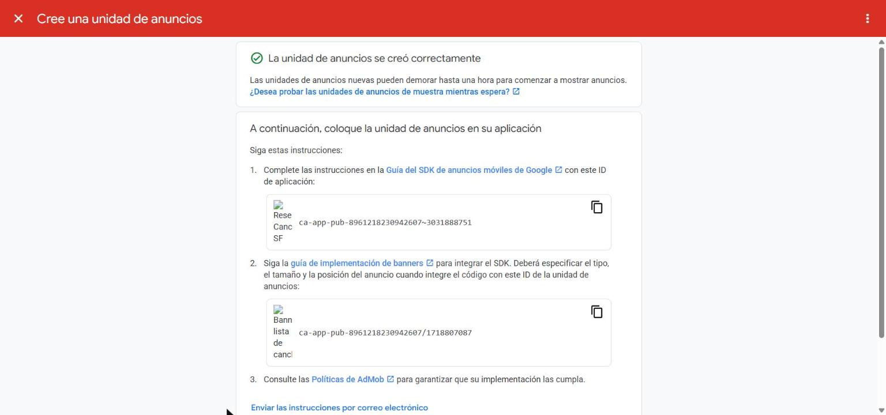
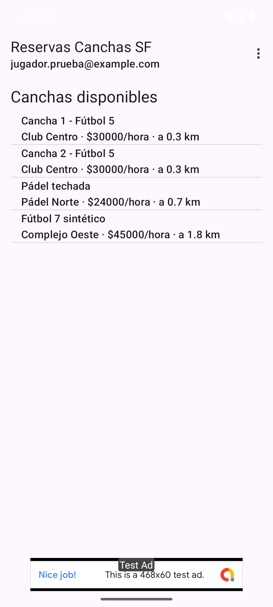
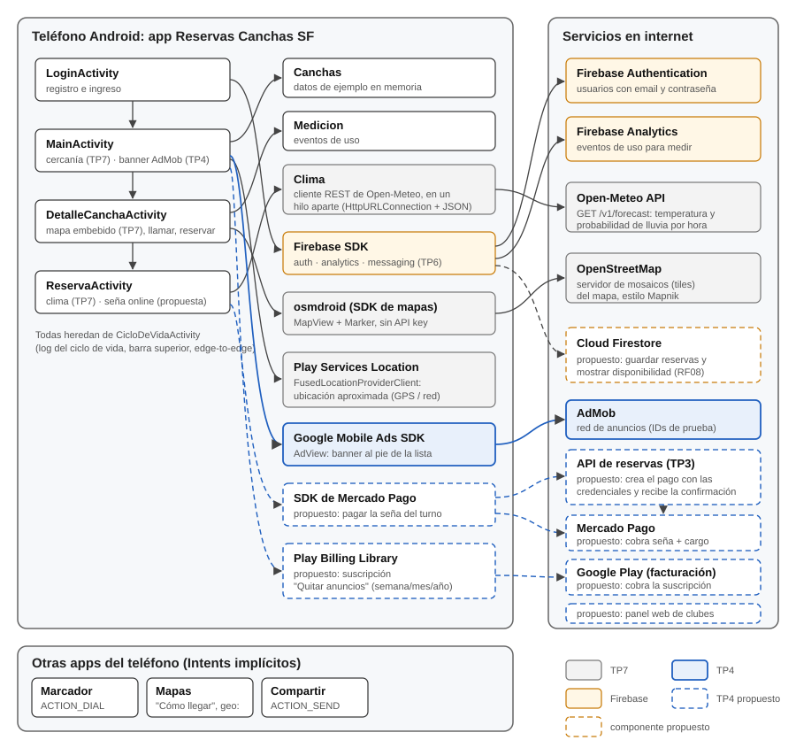

# Trabajo Práctico 4 — Monetización y Estrategias de Precios

**Cátedra:** Arquitecturas Móviles · Ing. Juan Pablo Bono  
**Carrera:** Ingeniería en Sistemas de Información — UTN FR San Francisco  
**Alumno:** Fernando Mare  
**Fecha:** 20/10/2026  
**Repositorio:** https://github.com/mareFernando03/reservas-canchas-sf

---

## 1. Objetivo

Según la guía del TP4: desarrollar una estrategia de monetización y precios para la app de los
prácticos anteriores (Reservas Canchas SF), implementar anuncios o compras in-app y actualizar el
diagrama de arquitectura.

## 2. Lectura: capítulo 17 de *Lean Mobile App Development*

El capítulo 17 ("Monetization and Pricing Strategy") parte de que es difícil cobrar por una app:
la gente gasta poco en el teléfono. Repasa estas estrategias:

- **Vender la app o el modelo freemium.** Cobrar la descarga sólo funciona si la app es muy
  conocida o su valor es muy claro. Lo habitual es el *freemium*: la app es gratis y se paga por
  funciones premium con compras in-app (*In-app Billing* en Android). El libro advierte que sólo
  entre el 1 % y el 5 % de los usuarios llega a pagar.
- **Vender un producto o servicio del mundo real.** Si lo que se cobra no es digital, el pago no
  tiene que pasar por la tienda, que se queda con el 30 %. El ejemplo es una app de
  estacionamiento que cobra un cargo fijo cada vez que se usa, con tarjeta, sin Apple ni Google en
  el medio.
- **App gratis y servicio pago.** Si la app es sólo uno de los canales del servicio, conviene
  ofrecerla gratis y cobrar el servicio, por ejemplo en la web.
- **Publicidad.** Es la forma más conocida, pero sólo rinde con muchos usuarios. Se integra con el
  SDK de una red de anuncios (AdMob, Inmobi, MoPub, entre otras; MoPub ya no existe). El banner al
  pie de la pantalla es lo que menos molesta, aunque el libro aclara que no siempre es lo que más
  rinde y propone probarlo con un test A/B. Se suele combinar con un botón "Quitar anuncios" pago,
  por única vez o como suscripción mensual o anual.
- **Monetizar los datos.** Posible con muchos usuarios y perfiles ricos, pero a los usuarios no
  les gusta: los datos tienen que ser anónimos.
- **Estrategia de precios.** La percepción del precio importa ($0,99 parece mucho menos que $1).
  Con tres opciones, una barata, una cara y una del medio, la del medio parece la mejor oferta. El
  precio correcto se encuentra probando: lo que importa no es cuántas ventas hay sino qué precio da
  el mayor ingreso.
- **Android o iOS primero.** Los usuarios de iOS gastan más en apps; en Android la publicidad
  parece funcionar mejor, porque la tasa de clics es mayor.

> **Nota.** La guía propone una discusión en grupo sobre los modelos de monetización. Este
> práctico se hizo de forma individual.

## 3. Estrategia de monetización

### 3.1. Modelos considerados

| Modelo del libro | ¿Aplica a la app? | Decisión |
|---|---|---|
| Vender la app (pago por descarga) | No. Nadie conoce la app y hay que competir con reservar gratis por WhatsApp. | Descartado. |
| Servicio del mundo real | Sí: lo que se vende es un turno en una cancha, que es un servicio físico. | **Ingreso principal.** |
| App gratis y servicio pago (web) | Sí, del lado de los clubes. | **Ingreso secundario.** |
| Publicidad | Con reservas. El libro avisa que la publicidad sólo rinde con una base de usuarios grande, y una app de una sola ciudad difícilmente la tenga. Se implementa porque la pide la guía y porque sostiene el producto "Quitar anuncios", no como una fuente de ingreso relevante. | **Implementado** en este práctico. |
| Freemium / compras in-app | Sólo para quitar la publicidad: reservar nunca puede ser una función paga. | **Propuesto.** |
| Monetizar datos | No. Los datos de ubicación y horarios de juego son sensibles, y la app depende de la confianza de los jugadores. Igual, el SDK de anuncios usa el ID de publicidad; eso se declara en la política de privacidad y en Play Console. | Descartado. |

### 3.2. La estrategia elegida

1. **Comisión por reserva (ingreso principal).** El jugador paga la seña del turno desde la app,
   con un proveedor de pagos (por ejemplo, Mercado Pago, el más usado en Argentina). Junto con la
   seña, el jugador paga un cargo fijo por reserva, como el cargo por uso del ejemplo de
   estacionamiento del libro. Como el turno es un servicio del mundo real, el pago no pasa por
   Google Play y no se paga su comisión (el libro, de 2017, habla del 30 %; hoy Google cobra 15 %
   sobre el primer millón de dólares anual). Sí se paga la comisión del proveedor de pagos, que es
   menor. A la vez, la seña resuelve un problema real de los clubes: los turnos que se reservan y no
   se usan.
2. **Plan para clubes (ingreso secundario).** Los clubes publican sus canchas gratis. Un plan
   mensual pago, en la web, agrega herramientas de gestión: grilla de turnos, estadísticas de
   ocupación y aparecer primero en la lista, con la etiqueta «Destacado». Es el modelo "app gratis
   y servicio pago" del libro, del lado de quien ofrece la cancha. El plan se contrata y se usa en
   la web; la app de Android no lo vende ni enlaza a la compra, para cumplir la política de pagos de
   Google Play.
3. **Publicidad (complemento).** Un banner al pie de la lista de canchas, el formato que el libro
   señala como el que menos molesta. Con AdMob no se eligen los anunciantes: los anuncios salen de
   la subasta de Google. Si más adelante se quisiera venderles el espacio a comercios locales (casas
   de deportes, indumentaria, bebidas), haría falta venta directa, por ejemplo con Google Ad Manager
   o con banners propios.
4. **Quitar anuncios (suscripción in-app).** Siguiendo la estructura de precios del libro, tres
   opciones: una semana, un mes y un año, con la mensual como la más conveniente a la vista (es el
   mismo ejemplo del libro, p. 435). Los
   montos en pesos se definen con experimentos (capítulos 13 y 14 del libro), no se fijan de
   antemano.

### 3.3. Hipótesis de precio a validar

Los números de esta tabla son **hipótesis de partida**, no resultados: el libro insiste en que el
precio se encuentra probando.

| Ítem | Hipótesis inicial | Cómo se valida |
|---|---|---|
| Cargo por reserva | Un cargo fijo, que paga el jugador junto con la seña, de unos $900 (alrededor del 3 % de un turno de fútbol 5 de $30.000). | Comparar la tasa de reservas confirmadas con distintos montos en períodos de prueba. |
| Conversión a "quitar anuncios" | Entre el 1 % y el 5 % de los usuarios activos, el rango que da el libro. | Medir con Analytics cuántos tocan el botón y cuántos compran. |
| Plan para clubes | Precio mensual a definir con los primeros clubes. | Entrevistas y un período de prueba gratis. |

## 4. Implementación: anuncios con AdMob

### 4.1. Cambios en el proyecto

| Componente | Cambio |
|---|---|
| `app/build.gradle.kts` | Dependencia `com.google.android.gms:play-services-ads:25.5.0` (Google Mobile Ads SDK). |
| `AndroidManifest.xml` | `meta-data` con el identificador de la app en AdMob. |
| `activity_main.xml` | Un `AdView` de tamaño `BANNER` al pie de la lista. |
| `CanchasApp` | Inicializa el SDK con `MobileAds.initialize()` una sola vez, en un hilo aparte, como recomienda Google. |
| `MainActivity` | Pide un anuncio con `loadAd(AdRequest)`. |

### 4.2. IDs de prueba

Para desarrollar, Google publica un identificador de app y bloques de anuncios **de prueba**:
muestran anuncios marcados como "Test Ad" y no generan ingresos ni cuentan como clics reales. Se
usaron esos porque, según la documentación de AdMob, tocar anuncios reales durante el desarrollo
puede hacer que la cuenta quede marcada por actividad inválida:

- App: `ca-app-pub-3940256099942544~3347511713`
- Banner: `ca-app-pub-3940256099942544/6300978111`

La configuración de la publicidad no depende de Play Console sino de AdMob, que es gratis y deja
registrar una app todavía no publicada: se crea la cuenta, se registra la app y se crea un bloque
de anuncios de tipo banner. En el código se dejan los IDs de prueba hasta publicar, para no generar
clics inválidos.

Se creó la cuenta de AdMob, se registró la app como todavía no publicada (Android, "Reservas
Canchas SF") y se creó un bloque de anuncios de tipo banner, "Banner lista de canchas" (figura 1).
AdMob marca la app como pendiente de revisión: para que muestre anuncios reales falta completar
el perfil de pagos y publicar la app en Google Play, y hasta entonces el código sigue con los
IDs de prueba. Al publicar, los dos IDs de prueba se reemplazan por los que muestra la figura.

<figure class="ancha"><figcaption>Figura 1. Bloque de anuncios banner creado en AdMob</figcaption></figure>

### 4.3. Prueba

Se probó en el emulador de Android Studio (Pixel, Android 16), con el login contra el emulador
local de Firebase Authentication como en los prácticos anteriores. Al abrir la lista, el SDK
inicializa, pide el anuncio y el banner de prueba aparece al pie, debajo de las canchas, sin tapar
la lista (figura 2).

<figure class="ancha"><figcaption>Figura 2. Lista de canchas con el banner de prueba de AdMob al pie</figcaption></figure>

## 5. Configuración en Google Play Console

La guía pide configurar la monetización en Google Play Console. **Esta parte no se hizo**: hace
falta una cuenta de desarrollador de Google Play, que es paga (USD 25), con un perfil de pagos
asociado, y además la app tiene que estar subida a algún canal de prueba antes de poder crear
productos in-app. Se documentan los pasos que habría que seguir para "Quitar anuncios" (los
nombres de los menús son los de la versión en español de la consola y pueden
cambiar):

1. Crear la cuenta de desarrollador y el perfil de pagos (*Configuración → Perfil de pagos*).
2. Crear la app en Play Console y subir una versión al canal de **prueba interna**, con la
   dependencia de Google Play Billing Library ya incluida.
3. Como quitar los anuncios por una semana, un mes o un año es un acceso por tiempo, no se carga
   como producto único (que no vence) sino como suscripción: en *Monetizar con Play → Productos →
   Suscripciones*, crear la suscripción `quitar_anuncios` con tres planes básicos (semanal, mensual
   y anual), cada uno con su precio en pesos. Si se prefiere que no se renueve sola, cada plan se
   configura como prepago.
4. Agregar las cuentas de prueba en *Configuración → Prueba de licencias*, para comprar sin que se
   cobre.
5. En la app, consultar los planes con `BillingClient.queryProductDetailsAsync()` (tipo `SUBS`) y
   lanzar la compra con `launchBillingFlow()`. Al confirmarse, reconocerla con
   `acknowledgePurchase()` (si no se reconoce en tres días, Google la reembolsa) y ocultar el
   `AdView`. El libro pide un botón de restaurar compras siguiendo la guía de Apple, y aclara que
   Google tiene algo parecido. En Android eso se resuelve llamando a `queryPurchasesAsync()` al
   abrir la app: quien cambia de teléfono recupera la suscripción sin hacer nada.
6. En *Política y programas → Contenido de la app*, declarar que la app **contiene anuncios** y que
   usa el **ID de publicidad** (el SDK de anuncios agrega solo el permiso `AD_ID`), y completar la
   sección **Seguridad de los datos** con lo que recopila ese SDK.

La seña de la reserva no se configura en Play Console: al ser un servicio del mundo real, se cobra
con el SDK del proveedor de pagos, fuera de la facturación de Google Play.

## 6. Diagrama de arquitectura actualizado

En azul, lo que agrega este práctico: el SDK de anuncios en la app y la red de AdMob. Con línea
punteada, lo propuesto, en dos circuitos separados. La seña se cobra con el SDK de Mercado Pago, y
el pago lo crea el backend de reservas del TP3, que también recibe la confirmación, porque las
credenciales de cobro no pueden estar en la app. "Quitar anuncios" se compra con Play Billing,
contra el servicio de facturación de Google Play. También con línea punteada, el panel web donde
los clubes contratan el plan mensual. El diagrama incluye lo integrado en los TP6 (notificaciones)
y TP7, hechos en paralelo.

<figure class="ancha grande"><figcaption>Figura 3. Arquitectura de la app con los componentes de monetización</figcaption></figure>

## Referencias

- van Drongelen, M., Dennis, A., Garabedian, R., Gonzalez, A. y Krishnaswamy, A. (2017).
  *Lean Mobile App Development*. Packt Publishing. Capítulo 17, "Monetization and Pricing
  Strategy".
- Google AdMob, "Enable test ads": https://developers.google.com/admob/android/test-ads
- Google Play, "Create an in-app product":
  https://support.google.com/googleplay/android-developer/answer/1153481
