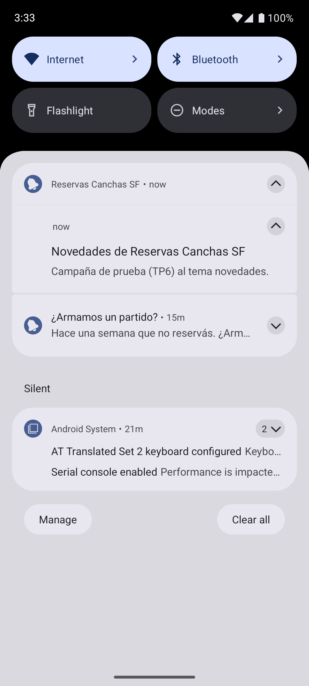
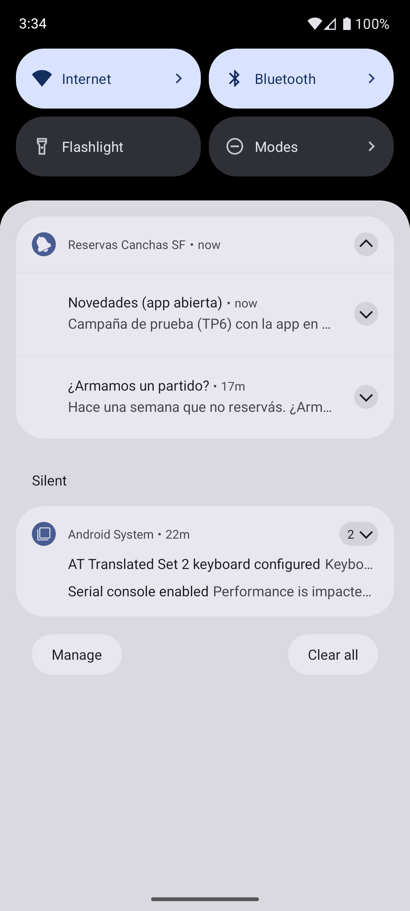
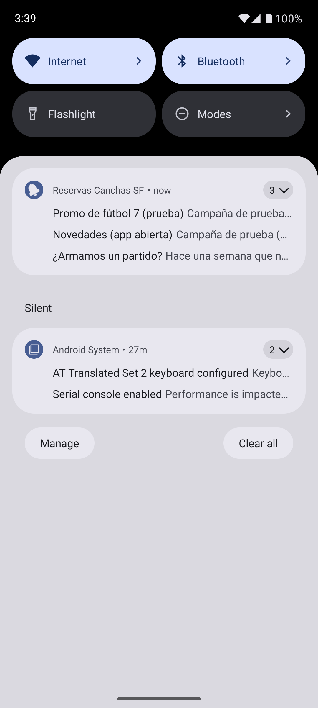
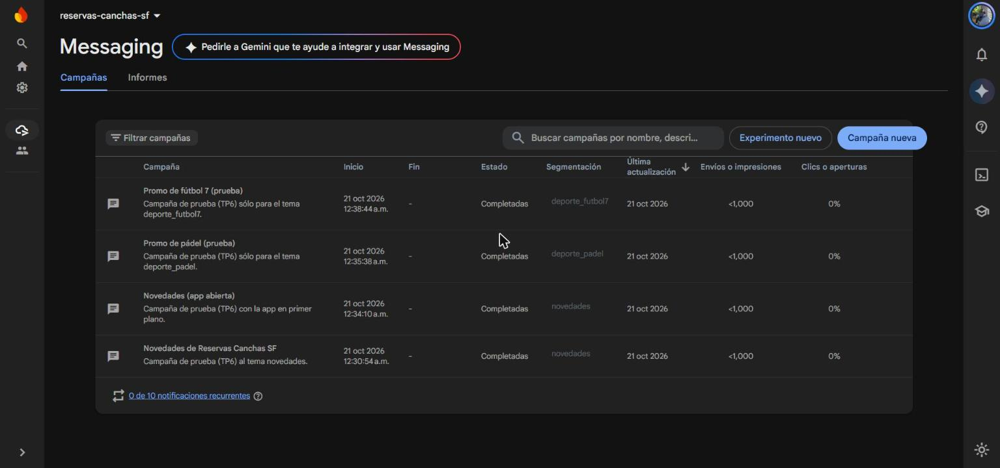
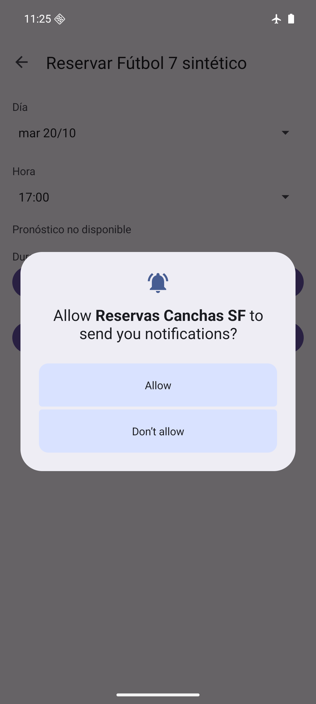
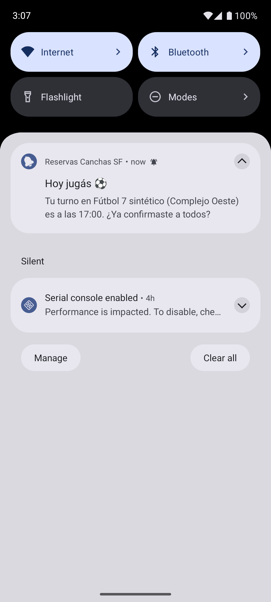
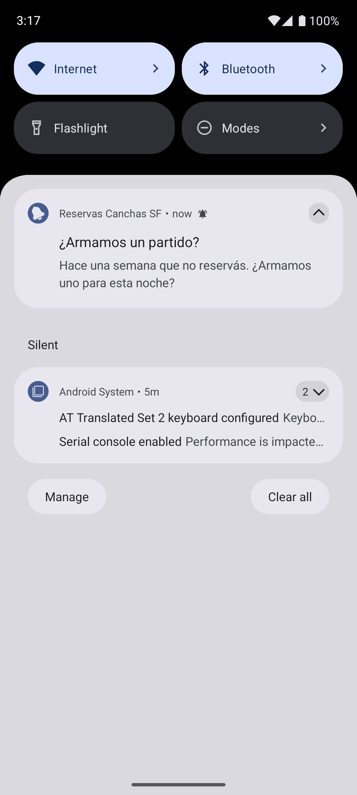
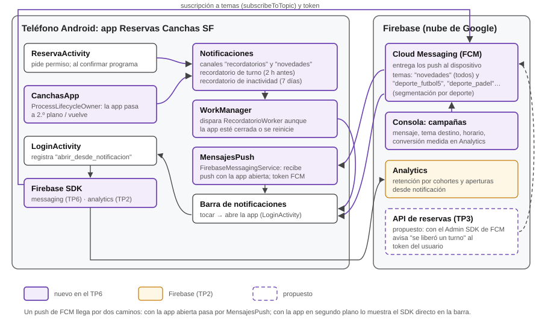

# Trabajo Práctico 6 — Estrategias de Retención de Usuarios

**Cátedra:** Arquitecturas Móviles · Ing. Juan Pablo Bono  
**Carrera:** Ingeniería en Sistemas de Información — UTN FR San Francisco  
**Alumno:** Fernando Mare  
**Fecha:** 21/10/2026  
**Repositorio:** https://github.com/mareFernando03/reservas-canchas-sf (incluye también lo de los
TP3, TP4 y TP7, hechos en paralelo; este informe trata sólo lo del TP6)

---

## 1. Objetivo

Según la guía del TP6: diseñar al menos tres estrategias para mejorar la retención de usuarios
de la app de los prácticos anteriores (Reservas Canchas SF), implementar notificaciones push con
Firebase Cloud Messaging, enviar campañas y actualizar el diagrama de arquitectura.

## 2. Lectura: capítulo 15 de *Lean Mobile App Development*

El capítulo 15 ("Growing Traction and Improving Retention") distingue dos métricas: la
**retención**, cada cuánto el usuario vuelve a abrir la app, y el **engagement**, qué hace
mientras la usa. El libro considera la retención probablemente la más importante, y su opuesto
es el **abandono** (*churn*): según los datos que cita, si una app no se abre al menos una vez por
semana, el 60 % de los usuarios puede olvidarse de ella (p. 374). Lo que se tomó para este
práctico:

- **Qué gana el usuario.** Siempre hay que preguntarse qué gana el usuario al volver. Las apps
  sociales retienen bien porque siempre hay algo nuevo (el miedo a perderse algo); la mayoría de
  las apps no se usan todos los días y necesitan otras razones.
- **Herramientas de retención.** Una incorporación (*onboarding*) sin barreras, contenido fresco,
  personalización, incentivos (*gamificación* con premios digitales o *incentivación* con premios
  del mundo real) y notificaciones push (p. 374-375).
- **Tres tipos de notificación.** Las **locales** las programa la propia app, como una alarma:
  no necesitan servidor ni internet. Las **push** las inicia un servidor y sirven para novedades
  y promociones, segmentadas por interés o por zona. Las **in-app** se muestran dentro de la app,
  como el pedido de calificarla (p. 377-380).
- **El ejemplo del libro.** Programar una notificación local cuando el usuario deja la app y
  cancelarla cuando vuelve: sólo le llega a quien de verdad se olvidó de la app (p. 378).
- **No molestar.** No mandar demasiados mensajes, segmentar para que lleguen sólo los
  relevantes, y probar qué mensajes y qué frecuencia convierten mejor. Según los datos que cita,
  quienes aceptan recibir push tienen en promedio un 25 % más de retención (p. 375-376).

**Una actualización respecto del libro.** El libro dice que en Android los push son *opt-out*:
llegan salvo que el usuario los desactive. Eso cambió en Android 13: ahora mostrar notificaciones
requiere el permiso `POST_NOTIFICATIONS`, que el usuario tiene que aceptar, igual que en iOS.
Además, el libro usa Google Cloud Messaging (GCM), que Google reemplazó por Firebase Cloud
Messaging (FCM) y dio de baja en 2019.

> **Nota.** La guía propone una discusión en grupo sobre buenas prácticas de retención. Este
> práctico se hizo de forma individual. Las páginas citadas son las de la edición en PDF del libro.

## 3. Estrategias de retención

La app se usa por ráfagas: se abre para reservar el partido de la semana y después no hace falta
hasta el siguiente. El riesgo es justamente el del libro: que pase una semana sin abrirla y el
usuario vuelva a reservar por WhatsApp.

| # | Estrategia | Tipo | Qué gana el usuario | Estado |
|---|---|---|---|---|
| 1 | **Recordatorio del turno**, dos horas antes del partido. | Notificación local | No olvidarse del partido y tener tiempo de avisar al grupo. | **Implementada** |
| 2 | **Recordatorio por inactividad**: si pasan 7 días sin abrir la app, una invitación a armar un partido. Se cancela cada vez que el usuario vuelve. | Notificación local | Un empujón para volver a jugar, sólo si se olvidó de la app. | **Implementada** |
| 3 | **Novedades segmentadas por deporte**: promociones y canchas nuevas, sólo del deporte que el usuario juega. | Push (FCM, temas) | Enterarse de lo que le interesa, sin recibir lo que no. | **Implementada y probada** (sección 5) |
| 4 | **Premio por constancia**: la 10.ª reserva con un descuento en la seña, acordado con los clubes. | Incentivación (premio del mundo real) | Un beneficio concreto por seguir usando la app. | Propuesta |
| 5 | **Aviso "se liberó un turno"** en una cancha y horario que el usuario ya buscó y estaba ocupado. | Push personalizado | Conseguir el turno que quería. | Propuesta (necesita el backend del TP3) |
| 6 | **Racha de partidos**: una insignia al reservar 3, 5 y 10 semanas seguidas, visible arriba de la lista de canchas. | Gamificación (premio digital) | Ver su constancia y no querer cortar la racha. | Propuesta |
| 7 | **Tu cancha de siempre**: la lista arranca con la última cancha reservada y un botón para repetir día y hora. | Contenido personalizado | Reservar el partido de la semana en un toque. | Propuesta |

Para no caer en el exceso de notificaciones que advierte el libro: hay un canal separado para los
recordatorios y otro para las novedades, así el usuario puede silenciar las promociones sin
perder los recordatorios. La invitación por inactividad va al canal de novedades: no avisa de un
turno, invita a volver. Y llega a las 19, no a cualquier hora: a los 7 días de la última visita,
pero nunca de madrugada. Además, cada mensaje llega a quien le sirve: el recordatorio del turno
sólo a quien reservó, el de inactividad sólo a quien se fue, y las novedades sólo a quien juega
ese deporte.

## 4. Implementación

### 4.1. Cambios en el proyecto

| Componente | Cambio |
|---|---|
| `app/build.gradle.kts` | `firebase-messaging` (por la BoM de Firebase), `androidx.work:work-runtime-ktx:2.12.0` y `androidx.lifecycle:lifecycle-process:2.11.0`. |
| `AndroidManifest.xml` | Permiso `POST_NOTIFICATIONS`, el servicio `MensajesPush` y el canal y el ícono por defecto de FCM. La app pasa a tener una clase de aplicación, `CanchasApp`. |
| `Notificaciones` | Nuevo. Canales, los dos recordatorios, la suscripción a temas y cómo se muestra cada notificación. |
| `RecordatorioWorker` | Nuevo. Muestra un recordatorio cuando WorkManager lo dispara. |
| `MensajesPush` | Nuevo. Recibe los push de FCM cuando la app está abierta. |
| `CanchasApp` | Nueva. Programa o cancela el recordatorio por inactividad cuando la app pasa a segundo plano o vuelve. |
| `ReservaActivity` | Pide el permiso de notificaciones y, al confirmar, programa el recordatorio y suscribe al tema del deporte. |
| `LoginActivity` | Si la app se abrió desde una notificación, lo registra en Analytics. |
| `MainActivity` | Al entrar a la lista, suscribe al tema `novedades`. |
| `Medicion` | Nuevo evento `abrir_desde_notificacion`. |
| `strings.xml` | Textos de los canales y de las notificaciones. |

### 4.2. Recordatorios locales con WorkManager

Los recordatorios se programan con **WorkManager**, la biblioteca de Android para trabajos que
tienen que ejecutarse aunque la app esté cerrada o el teléfono se reinicie. Al confirmar la
reserva se encola un trabajo con una espera calculada hasta dos horas antes del turno; cuando se
cumple, `RecordatorioWorker` muestra la notificación. Si el turno es dentro de menos de dos horas,
no se programa. Cada turno es un **trabajo único** con nombre: si se reserva dos veces el mismo,
queda un solo recordatorio. Las horas se calculan en la zona horaria de San Francisco, aunque el
teléfono esté configurado en otra.

El recordatorio por inactividad también es un trabajo único: cada vez que el usuario deja la app se
reemplaza por uno nuevo para dentro de 7 días a las 19, y cada vez que vuelve se cancela.

WorkManager no garantiza la hora exacta: con el teléfono en reposo (Doze) puede demorar el aviso
unos minutos, lo que para un recordatorio con dos horas de margen alcanza. Si el usuario fuerza la
detención de la app, Android cancela los trabajos pendientes hasta que la vuelva a abrir.

**Un error encontrado al probar.** La primera versión programaba ese recordatorio en el `onStop()`
de la lista de canchas. Pero `onStop()` también se ejecuta cuando el usuario pasa de la lista al
detalle de una cancha, sin salir de la app. Se corrigió con `ProcessLifecycleOwner`, que avisa
cuándo pasa a segundo plano la **app entera** y no cada pantalla.

### 4.3. Notificaciones push con Firebase Cloud Messaging

- **Permiso.** En Android 13 o superior se pide `POST_NOTIFICATIONS` al abrir la pantalla de
  reserva, donde se entiende para qué es (el recordatorio del turno), y no apenas se abre la app.
  Si el usuario lo rechaza, reservar funciona igual, pero no recibe ni los recordatorios ni las
  novedades: los trabajos se ejecutan y la app no publica nada. El pedido se repite al volver a
  reservar, y después de dos rechazos Android deja de mostrarlo.
- **Canales.** "Recordatorios de turnos", con importancia alta, y "Novedades y promociones", con
  importancia normal.
- **Segmentación por temas.** Al entrar a la lista de canchas, todos se suscriben al tema `novedades`; al
  reservar, cada usuario se suma al tema de su deporte (`deporte_futbol5`, `deporte_futbol7`,
  `deporte_padel`). Una campaña enviada al tema `deporte_padel` sólo les llega a quienes reservaron
  pádel.
- **Recepción.** Con la app en segundo plano, Android muestra el push solo, en el canal
  "novedades". Con la app abierta lo recibe `MensajesPush.onMessageReceived()`, que lo muestra con
  el mismo título, texto e ícono. Los mensajes sólo de datos se ignoran: las campañas de la
  consola siempre son de notificación.
- **Medición.** Tocar un recordatorio abre la app con su origen (`recordatorio_turno` o
  `recordatorio_inactividad`). Los push que muestra el sistema con la app cerrada no pasan por el
  código de la app: `LoginActivity` los reconoce por los datos que agrega FCM y los registra con
  origen `push`. Todo queda en Analytics como `abrir_desde_notificacion`, el dato que permite
  comparar qué mensajes hacen volver a la gente. Además, FCM registra solo la recepción y la
  apertura de cada campaña. Si la app ya estaba abierta, tocar la notificación la reinicia en la
  lista, en vez de apilar pantallas repetidas.

## 5. Configuración y envío de campañas

**Configuración.** FCM usa el mismo proyecto de Firebase que la autenticación (TP2), así que no
hubo que crear credenciales nuevas. Al iniciar, la app obtiene su *token* de FCM, que se ve en el
registro del emulador; si cambia (por ejemplo, al reinstalar), `onNewToken()` lo vuelve a
registrar. El token no se manda a ningún servidor porque las campañas van por tema; guardarlo en
el backend es lo que haría falta para la estrategia 5.

**Envío de campañas desde la consola de Firebase:** *Messaging → Nueva campaña → Notificaciones*,
con título y texto, destino por **tema** (por ejemplo, `deporte_padel`) y horario de envío. La
consola muestra después cuántos la recibieron y la abrieron.

**Campañas enviadas.** El 21/10 se enviaron cuatro campañas de prueba desde la consola, con el
emulador como destinatario. El emulador estaba suscripto a `novedades` y, por las reservas hechas
en las pruebas, a `deporte_futbol5` y `deporte_futbol7`; nunca reservó pádel.

| Campaña | Tema | Estado de la app | Resultado |
|---|---|---|---|
| "Novedades de Reservas Canchas SF" | `novedades` | En segundo plano | Llegó a los ~30 s; la mostró el sistema, con el ícono configurado (figura 1). Al tocarla, Analytics registró `abrir_desde_notificacion` con `origen=push` (verificado en el registro de Analytics del emulador). |
| "Novedades (app abierta)" | `novedades` | En primer plano | Llegó a los ~20 s y la mostró `MensajesPush`: con la app abierta, Android no muestra solo un push (figura 2). |
| "Promo de pádel (prueba)" | `deporte_padel` | En primer plano | **No llegó** en los dos minutos siguientes: el emulador no está en ese tema. |
| "Promo de fútbol 7 (prueba)" | `deporte_futbol7` | En primer plano | Llegó a los ~25 s (figura 3). Es el control de la anterior: el mismo envío, a un tema en el que el emulador sí está. |

La consola muestra las cuatro campañas como completadas (figura 4). Para cantidades chicas no da
el número exacto de envíos ("<1.000"), y las aperturas aparecen en la consola con demora, cuando
Analytics procesa los eventos; por eso la apertura se verificó en el registro del dispositivo.

<figure><figcaption>Figura 1. Campaña recibida con la app en segundo plano</figcaption></figure>
<figure><figcaption>Figura 2. Campaña recibida con la app abierta</figcaption></figure>
<figure><figcaption>Figura 3. Llega la de fútbol 7; la de pádel no</figcaption></figure>

<figure class="ancha"><figcaption>Figura 4. Las cuatro campañas en la consola de Firebase</figcaption></figure>

## 6. Pruebas

Se probó en el emulador de Android Studio (Pixel, Android 16). Para no esperar dos horas ni siete
días, se compiló con la opción `-PrecordatorioPrueba=true`, que reduce las esperas a 10 y 20
segundos. Con la compilación normal se usan las esperas reales.

| Prueba | Resultado |
|---|---|
| Abrir la reserva por primera vez | Android pide el permiso de notificaciones (figura 5). |
| Confirmar una reserva | A los 10 s llega "Hoy jugás", con la cancha, el club y la hora (figura 6). |
| Rechazar el permiso de notificaciones y confirmar una reserva | La reserva se confirma y el recordatorio se programa, pero la app no publica ninguna notificación. |
| Quedarse 30 s en el detalle de una cancha, sin salir de la app | No llega el recordatorio por inactividad: la app sigue en primer plano. |
| Salir de la app con el botón de inicio | A los 20 s llega "¿Armamos un partido?", en el canal de novedades (figura 7). |
| Token de FCM | Se genera al abrir la app y se registra en el log. |

<figure><figcaption>Figura 5. Permiso de notificaciones al reservar</figcaption></figure>
<figure><figcaption>Figura 6. Recordatorio del turno</figcaption></figure>
<figure><figcaption>Figura 7. Recordatorio por inactividad</figcaption></figure>

## 7. Diagrama de arquitectura actualizado

En violeta, lo que agrega este práctico: el módulo de notificaciones, WorkManager, el servicio que
recibe los push, el SDK de mensajería y Firebase Cloud Messaging con sus temas y campañas. Se ven
los dos caminos de un push: con la app en segundo plano lo muestra el SDK directamente, y con la
app abierta pasa por `MensajesPush`. Con línea punteada, la API de reservas del TP3, propuesta
para el aviso de turno liberado: enviaría el push al token del usuario.

<figure class="ancha"><figcaption>Figura 8. Arquitectura de la app con los mecanismos de retención</figcaption></figure>

## Referencias

- van Drongelen, M., Dennis, A., Garabedian, R., Gonzalez, A. y Krishnaswamy, A. (2017).
  *Lean Mobile App Development*. Packt Publishing. Capítulo 15, "Growing Traction and Improving
  Retention".
- Firebase, "Topic messaging on Android": https://firebase.google.com/docs/cloud-messaging/android/topic-messaging
- Android Developers, "Notification runtime permission":
  https://developer.android.com/develop/ui/views/notifications/notification-permission
- Android Developers, "WorkManager": https://developer.android.com/topic/libraries/architecture/workmanager
