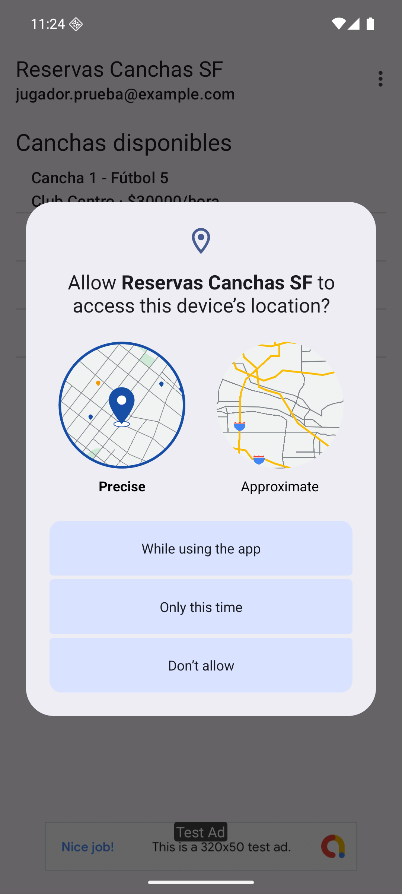
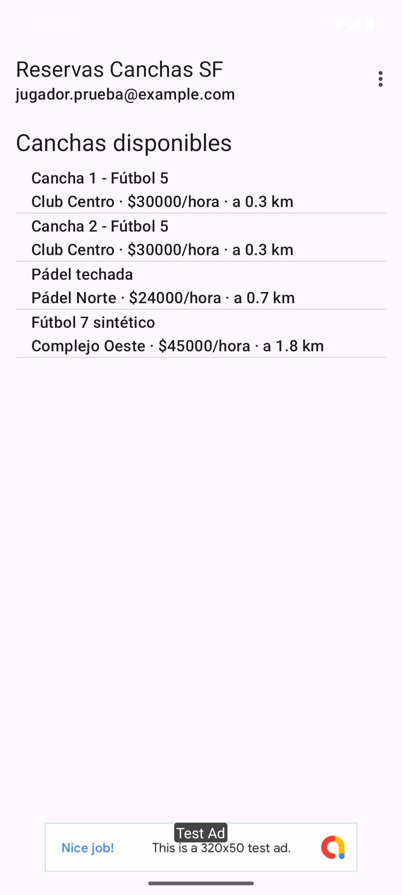
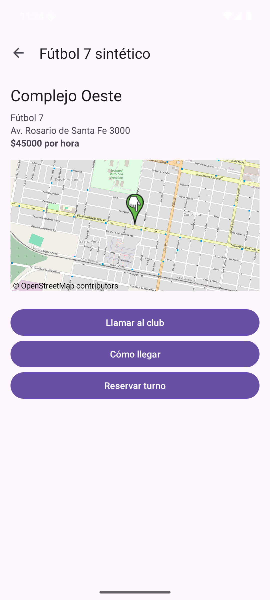
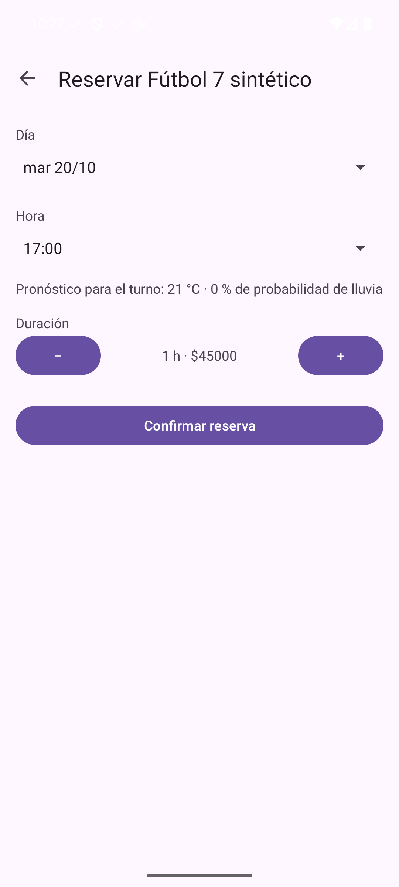
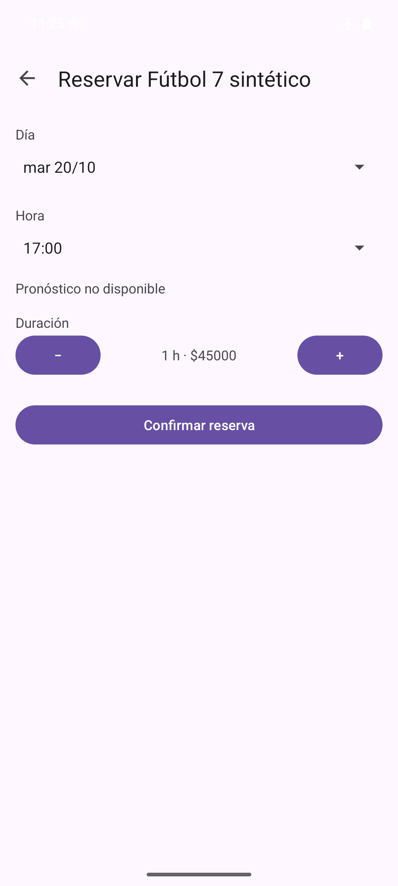
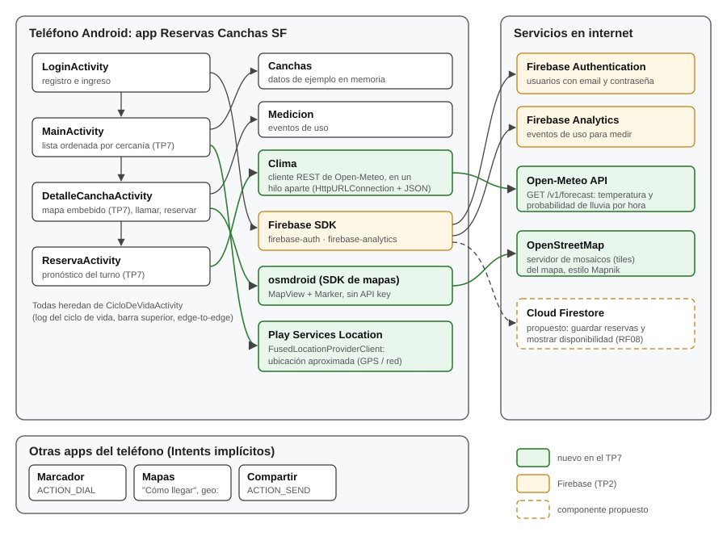

# Trabajo Práctico 7 — Integración de APIs y SDKs

**Cátedra:** Arquitecturas Móviles · Ing. Juan Pablo Bono  
**Carrera:** Ingeniería en Sistemas de Información — UTN FR San Francisco  
**Alumno:** Fernando Mare  
**Fecha:** 21/10/2026  
**Repositorio:** https://github.com/mareFernando03/reservas-canchas-sf (incluye también lo de los
TP3, TP4 y TP6, hechos en paralelo; este informe trata sólo lo del TP7)

---

## 1. Objetivo

Según la guía del TP7: integrar APIs y SDKs en una aplicación móvil para mejorar su
funcionalidad. Se parte de la app de los prácticos anteriores (Reservas Canchas SF), se
seleccionan tres integraciones nuevas, se implementan y se prueban, y se actualiza el diagrama de
arquitectura.

## 2. Lectura: capítulo 10 de *Lean Mobile App Development*

El capítulo 10 ("There Is an API for That!") plantea armar un **mash-up**: en lugar de
desarrollar todo desde cero, combinar apps, datos y servicios de terceros para validar una
hipótesis con el mínimo esfuerzo. Las ideas que se tomaron para este práctico son:

- **Fallar o acertar rápido.** Un mash-up permite probar una idea antes de invertir en una
  solución propia. Además, al apoyarse en APIs o SDKs de plataformas más grandes se usa
  tecnología probada, menos propensa a errores. El ejemplo del libro es el pago: si se quieren
  cobrar pagos fuera de las compras in-app, se usa la solución de un proveedor de pagos (p. 231).
- **Qué es un mash-up.** Consume datos de una o más fuentes, los presenta de otra forma y/o les
  agrega lógica. El libro destaca que los más populares hacen justamente eso: mostrar datos
  existentes de otra manera, por ejemplo en un mapa en lugar de una lista (p. 229 y 232).
- **Lego o Duplo.** Usar soluciones de terceros es como construir con Duplo en lugar de Lego: se
  avanza más rápido y probablemente más barato, y el esfuerzo se concentra en la propuesta de
  valor propia (p. 234).
- **API versus SDK.** Una API es la interfaz, en general un servicio REST. Un SDK es la
  implementación de esa API para una plataforma (Android, iOS) y simplifica la integración. El
  libro usa como ejemplo la dependencia de Firebase en Gradle: el SDK se encarga de hablar con la
  API (p. 235).
- **Gestión de dependencias.** Las APIs y SDKs se actualizan seguido. En Android se recomienda
  declararlos como dependencias externas de Gradle, en lugar de copiar librerías al proyecto
  (p. 236-237). El ejemplo del libro usa `compile`, que quedó obsoleto: hoy es `implementation`, y
  el archivo en este proyecto es `build.gradle.kts`.
- **APIs disponibles.** Hay datos públicos sobre casi cualquier tema. Mientras se puedan consumir
  como JSON o XML, no importa que la API no haya sido pensada para móviles. El libro menciona el
  clima como una fuente de datos muy usada (p. 241).
- **Desafíos.** El capítulo advierte que las APIs y SDKs cambian seguido y que eso exige un plan
  de dependencias (p. 236). En este práctico aparecieron otros: la app pasa a depender de la
  disponibilidad y de las condiciones de uso de terceros (Open-Meteo es gratis sólo para uso no
  comercial; OpenStreetMap exige identificar la app y mostrar la atribución), de que el teléfono
  tenga Google Play Services (la ubicación) y de que haya conexión. Por eso cada integración se
  diseñó para que, si falla, la reserva siga funcionando. Y osmdroid no tiene versiones nuevas desde
  la 6.1.20: es un ejemplo concreto del riesgo de depender de un SDK de terceros.

> **Nota.** La guía propone una discusión en grupo sobre los beneficios y desafíos de integrar
> APIs y SDKs. Este práctico se hizo de forma individual. Las páginas citadas son las de la
> edición en PDF del libro.

## 3. Selección de APIs y SDKs

La app ya integraba, desde el TP2, **Firebase Authentication** y **Firebase Analytics**. Para este
práctico se sumaron tres integraciones nuevas (el SDK de anuncios y Firebase Cloud Messaging
corresponden a los TP4 y TP6). El criterio fue que cada una resolviera una duda
real de quien reserva una cancha y que ninguna exigiera una clave de API, para que el proyecto se
pueda compilar y probar sin credenciales.

| Integración | Tipo | Qué resuelve en la app | Por qué esta y no otra |
|---|---|---|---|
| **osmdroid** 6.1.20 | SDK (mapas de OpenStreetMap) | Muestra en el detalle un mapa con la ubicación de la cancha, sin salir de la app. | Es la idea de mash-up del libro: el mismo dato (la dirección) presentado en un mapa. Google Maps SDK pide una API key con facturación habilitada; osmdroid usa los mapas libres de OpenStreetMap. |
| **Open-Meteo** | API REST pública | Al elegir día y hora del turno, muestra la temperatura y la probabilidad de lluvia para esa hora en la cancha. | En fútbol 5 y 7 al aire libre, la lluvia decide si se juega. Open-Meteo no pide registro ni clave y devuelve el pronóstico por hora en JSON. Es gratis sólo para uso no comercial: si la app cobrara, habría que pasar a su plan pago. Se consume con `HttpURLConnection` y el JSON de Android, en lugar de Retrofit (el ejemplo del libro, p. 237): es una dependencia menos. |
| **Google Play Services Location** 21.4.0 | SDK (ubicación) | Ordena la lista de canchas de la más cercana a la más lejana y muestra la distancia. | El proveedor de ubicación fusionado combina GPS, wifi y red móvil y es el recomendado en Android. No funciona en teléfonos sin Google Play Services (la alternativa sería `LocationManager`). Hace falta la ubicación precisa: la aproximada se corre 1 a 2 km, lo mismo que separa a las canchas (ver sección 6). |

Con las dos de Firebase, son cinco APIs/SDKs; contando las de los TP4 y TP6, la app integra siete.

## 4. Implementación

### 4.1. Cambios en el proyecto

| Componente | Cambio |
|---|---|
| `app/build.gradle.kts` | Dependencias `org.osmdroid:osmdroid-android:6.1.20` y `com.google.android.gms:play-services-location:21.4.0`. Open-Meteo no necesita dependencia: se consume con las clases de Android. |
| `AndroidManifest.xml` | Permisos `ACCESS_NETWORK_STATE` (lo usa osmdroid), `ACCESS_COARSE_LOCATION` y `ACCESS_FINE_LOCATION`. |
| `Clima` | Nuevo. Cliente de la API de Open-Meteo. |
| `DetalleCanchaActivity` | Mapa embebido (`MapView`) con un marcador en la cancha y la atribución de OpenStreetMap. "Cómo llegar" sigue abriendo la app de mapas del teléfono. |
| `ReservaActivity` | Muestra el pronóstico cada vez que cambia el día o la hora del turno. |
| `MainActivity` | Pide el permiso de ubicación y, si se concede, ordena la lista por distancia. |

### 4.2. osmdroid

En el layout del detalle se agregó un `org.osmdroid.views.MapView`. Al crear la pantalla se lo
centra en las coordenadas de la cancha con zoom 16 y se le agrega un `Marker` con el nombre del
club. Detalles propios del SDK:

- Antes de inflar el layout se carga la configuración de osmdroid
  (`Configuration.getInstance().load(...)`), que indica dónde guardar el caché de mosaicos.
- Los servidores de OpenStreetMap exigen que cada app se identifique al pedir los mosaicos del
  mapa. Por eso se fija `Configuration.getInstance().userAgentValue = packageName`.
- La política de OpenStreetMap también exige mostrar la atribución "© OpenStreetMap
  contributors" sobre el mapa; se agregó con el `CopyrightOverlay` del SDK.
- El mapa está dentro de un `ScrollView`, que se quedaría con los arrastres verticales. Al tocar
  el mapa se le pide al contenedor que no intercepte el gesto, para poder moverlo en cualquier
  dirección.
- El mapa tiene su propio ciclo de vida: `onResume()` y `onPause()` de la Activity llaman a los
  del `MapView`, para que deje de descargar y dibujar cuando la pantalla no está visible.

### 4.3. Open-Meteo

`Clima.pronostico(latitud, longitud, fecha, hora, listo)` hace un `GET` a

```
https://api.open-meteo.com/v1/forecast?latitude=…&longitude=…
  &hourly=temperature_2m,precipitation_probability
  &timezone=America/Argentina/Cordoba&start_date=AAAA-MM-DD&end_date=AAAA-MM-DD
```

La respuesta trae, para cada hora del día, la temperatura y la probabilidad de precipitación en
arreglos paralelos. `Clima` busca la posición de la hora del turno (por ejemplo
`2026-10-20T17:00`) y devuelve esos dos valores.

Android no deja usar la red desde el hilo principal (lanza `NetworkOnMainThreadException`), así
que el pedido corre en un hilo aparte (`Executors.newSingleThreadExecutor()`) y el resultado
vuelve al hilo principal con un `Handler` para actualizar la pantalla. Si no hay conexión, se
agota el tiempo de espera (5 s para conectar y 5 s para leer) o la respuesta no es la esperada,
se muestra "Pronóstico no disponible" y la reserva sigue funcionando. Como la respuesta puede
llegar después de que el usuario cerró la pantalla, antes de tocar la vista se verifica que la
Activity siga activa. Como el hilo atiende los pedidos de a uno y en orden, la última respuesta
que llega es siempre la del último turno elegido.

Cada cambio de día u hora hace un pedido, y al abrir la pantalla salen dos (uno por cada selector).
Una mejora posible es pedir en una sola consulta los 7 días que muestra la grilla.

### 4.4. Google Play Services Location

`MainActivity` pide juntos `ACCESS_FINE_LOCATION` y `ACCESS_COARSE_LOCATION` con
`ActivityResultContracts.RequestMultiplePermissions()`, que muestra el diálogo del sistema. Desde
Android 12 el usuario elige ahí entre ubicación precisa y aproximada (figura 1). El pedido se hace
la primera vez que se abre la lista, no al rotar la pantalla, y no se repite si el permiso ya está.

Con ubicación precisa, `FusedLocationProviderClient.getCurrentLocation()` devuelve la ubicación
actual, `Location.distanceBetween()` calcula la distancia a cada cancha y la lista se reordena
mostrando "a X km". Si el usuario elige la aproximada o no da permiso, la lista queda en el orden
original. Lo mismo si la ubicación del teléfono está apagada o el dispositivo no tiene Google Play
Services: el pedido no devuelve posición y no pasa nada. La ubicación mejora la app pero no es
necesaria para reservar.

Se usa la prioridad `PRIORITY_HIGH_ACCURACY` porque, con prioridad balanceada, el proveedor
fusionado se apoya en la ubicación por red y en el emulador devolvía `null` (ver sección 6). En un
teléfono real la prioridad balanceada alcanzaría y gasta menos batería; se dejó alta precisión
para poder probar con `geo fix`.

## 5. Pruebas

Se probó en el emulador de Android Studio (Pixel, Android 16), con el login contra el emulador
local de Firebase Authentication, como en el TP2. La posición del teléfono se fijó en el centro de
San Francisco (latitud −31,4250, longitud −62,0850) con el comando `geo fix` del emulador.

| Integración | Prueba | Resultado |
|---|---|---|
| Location | Abrir la lista y conceder ubicación precisa "Mientras se usa la app". | La lista se reordena: Club Centro a 0,3 km, Pádel Norte a 0,7 km y Complejo Oeste último (figura 2). Coincide con las coordenadas de cada cancha. |
| Location | Revocar el permiso y volver a abrir la lista. | La lista queda en el orden original, sin distancias. |
| osmdroid | Abrir el detalle del Fútbol 7 sintético. | Se ve el mapa de San Francisco con el marcador en la cancha y la atribución de OpenStreetMap (figura 3). |
| Open-Meteo | Abrir la reserva de esa cancha para hoy a las 17:00. | Muestra 21 °C y 0 % de probabilidad de lluvia (figura 4). |
| Open-Meteo | Consultar la misma URL directamente, para comparar. | La API devolvió 20,9 °C y 0 % para esa hora: coincide con lo que muestra la app, redondeado. |
| Open-Meteo | Abrir la reserva con el emulador en modo avión. | Muestra "Pronóstico no disponible" y se puede confirmar la reserva igual (figura 5). |

<div class="capturas">
<figure><figcaption>Figura 1. Permiso de ubicación: precisa o aproximada</figcaption></figure>
<figure><figcaption>Figura 2. Lista ordenada por cercanía</figcaption></figure>
<figure><figcaption>Figura 3. Detalle con el mapa de osmdroid</figcaption></figure>
<figure><figcaption>Figura 4. Reserva con el pronóstico de Open-Meteo</figcaption></figure>
<figure><figcaption>Figura 5. Sin conexión: la reserva sigue funcionando</figcaption></figure>
</div>

## 6. Problemas encontrados

| Problema | Solución |
|---|---|
| Google Maps SDK pide una API key con facturación habilitada en Google Cloud. | Se usó osmdroid con mapas de OpenStreetMap, que no requieren clave. |
| La ubicación volvía siempre `null` en el emulador. | Con `PRIORITY_BALANCED_POWER_ACCURACY` el proveedor fusionado usa la ubicación por red, que el emulador no simula. Con `PRIORITY_HIGH_ACCURACY` usa el GPS, que sí se puede fijar con `geo fix`. |
| La llamada a la red no puede hacerse en el hilo principal. | El pedido a Open-Meteo corre en un hilo aparte y el resultado vuelve con un `Handler`. |
| OpenStreetMap bloquea los pedidos de mosaicos de apps que no se identifican. | Se configura el *user agent* de osmdroid con el nombre del paquete de la app. |
| La primera versión pedía sólo la ubicación aproximada, y la lista salía mal ordenada: con el teléfono en el centro, Club Centro aparecía última. Android corre la ubicación aproximada 1 a 2 km, lo mismo que separa a las canchas. | Se pide también la ubicación precisa, y sólo con ella se reordena la lista. |

## 7. Diagrama de arquitectura actualizado

En verde, lo que se agregó en este práctico: el módulo `Clima`, los SDKs de osmdroid y de
ubicación, y los servicios externos que consumen (la API de Open-Meteo y el servidor de mapas de
OpenStreetMap). Cloud Firestore sigue como componente propuesto para guardar las reservas.

<figure class="ancha"><figcaption>Figura 6. Arquitectura de la app después del TP7</figcaption></figure>

## 8. Cómo mejoran la funcionalidad de la app

Antes de este práctico, para saber dónde quedaba una cancha había que salir a la app de mapas, y
nada indicaba cuál estaba más cerca ni si iba a llover a la hora del partido. Con las tres
integraciones, la app responde esas tres dudas en el momento de elegir: qué cancha conviene por
distancia, dónde está y si el turno elegido es buena idea para jugar al aire libre. Es lo que el
capítulo 10 llama un mash-up: datos que ya existían (las coordenadas de cada cancha, el
pronóstico, la posición del teléfono) combinados y presentados de otra forma, sin desarrollar
ninguno de esos servicios.

Siguiendo el capítulo, cada integración es además una hipótesis a validar: "quien reserva elige
por cercanía" y "quien juega al aire libre mira el clima antes de confirmar". Con el Analytics del
TP2 se pueden medir: qué cancha se abre según su posición en la lista ordenada, y cuántas reservas
se confirman después de ver el pronóstico.

## Referencias

- van Drongelen, M., Dennis, A., Garabedian, R., Gonzalez, A. y Krishnaswamy, A. (2017).
  *Lean Mobile App Development*. Packt Publishing. Capítulo 10, "There Is an API for That!".
- osmdroid: https://github.com/osmdroid/osmdroid
- Open-Meteo, Weather Forecast API: https://open-meteo.com/en/docs
- Android Developers, "Get the current location":
  https://developer.android.com/develop/sensors-and-location/location/retrieve-current
